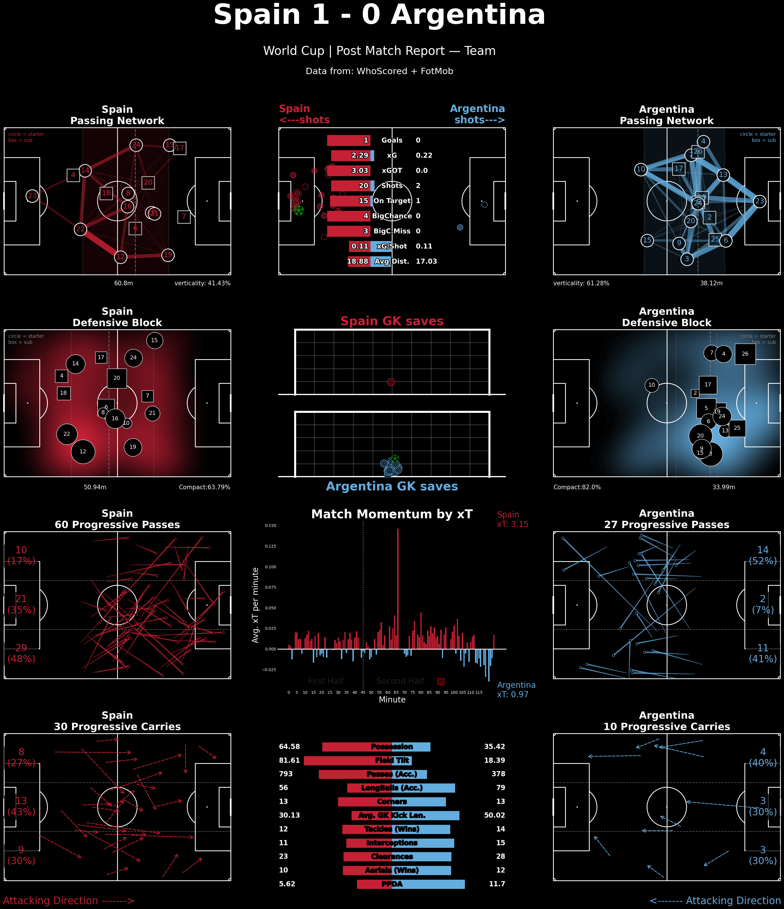
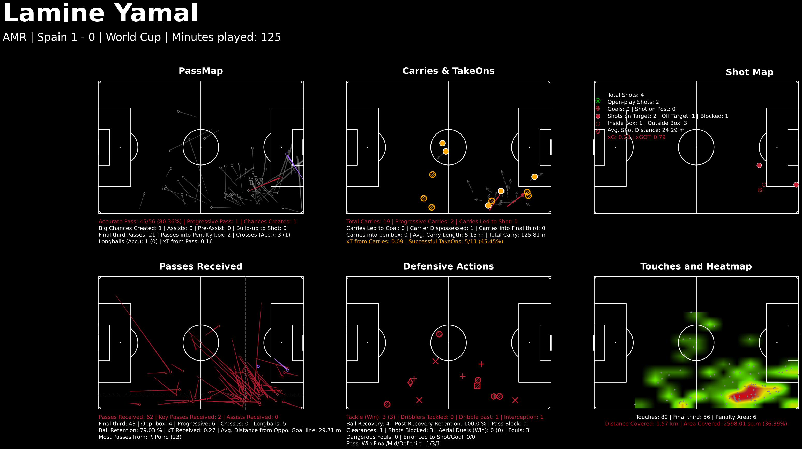
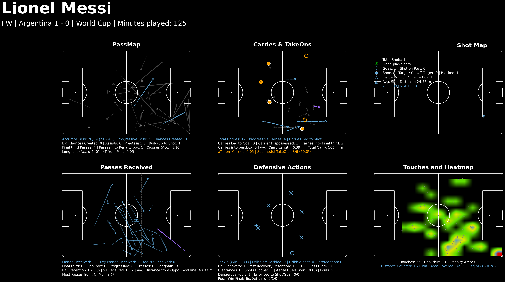

# football-analytics-tutorials

Professional post-match team reports from **WhoScored + FotMob** — a clean
Python package + an agent skill, built on the
[Post-Match-Report-2.0](https://github.com/adnaaan433/Post-Match-Report-2.0)
blueprint.



Player-level dashboards (one 2x3 page per starter, from the same bundle):





## What it does

Given **any WhoScored match URL**, the pipeline:

1. **Scrapes WhoScored** (headless Chromium) → full event stream: passes,
   tackles, carries, recoveries with coordinates.
2. **Auto-resolves the FotMob match id** from the match date + team names →
   shots with xG/xGOT, native momentum, official stats, player of the
   match, real team colors.
3. **Renders two 4x3 report figures** (UEFA pitch, black background,
   blueprint styling): passing networks with shirt-number nodes, shot map,
   defensive blocks, goalkeeper saves, progressive passes/carries,
   xT momentum, match stats, final-third entries, box entries, Zone 14,
   crosses, pass-end zones, high turnovers, chance creation, congestion.
4. **Renders player-level reports**: a 4x3 Top Players dashboard (top
   progressor pass maps, passes received, top defender actions, GK pass
   maps, Top10 bar charts) plus a 2x3 dashboard per starter (pass map,
   carries & take-ons, shot map with xG/xGOT, passes received, defensive
   actions, touches heatmap) and a merged `player_stats.csv`.

No API keys, no manual Selenium sessions, no rotating tokens, no hardcoded
team ids — works for any match (Club World Cup, Premier League, etc.).

## Quick start

```bash
# 1. Install (uv)
uv sync --extra scrape

# 2. One-time browser install (for WhoScored)
uv run playwright install chromium

# 3. Scrape any match (WhoScored + FotMob merged)
uv run football-match-report scrape \
  "https://www.whoscored.com/matches/2007644/live/international-fifa-world-cup-2026-spain-argentina" \
  --out ./data

# 4. Render the two report figures (offline)
uv run football-match-report render --data ./data --out ./report

# 5. Render the player-level reports (offline)
uv run football-match-report players --data ./data --out ./report
```

Outputs: `report/match_report_1.png` (team report) +
`report/match_report_2.png` (zones report) +
`report/match_report_3.png` (Top Players dashboard) +
`report/players/<name>.png` (per-starter dashboards) +
`report/player_stats.csv` (per-player stat table).

Pass `--players "Lamine Yamal,Mikel Oyarzabal"` to limit the per-player
dashboards to specific names (the Top Players dashboard and CSV are
always rendered).

## Repository layout

```
src/football_match_report/     # the package
  core/events.py               # event pipeline: carries, possession, xT, UEFA scaling
  core/stats.py                # match/shot statistics
  core/player_stats.py         # per-player stats: leaderboards + 6 facets + playing time
  io/whoscored.py              # Playwright scraper
  io/fotmob.py                 # FotMob API (id resolve, matchDetails)
  viz/pass_network.py          # passing networks (shirt numbers, line heights)
  viz/defensive_block.py       # defensive KDE heatmaps
  viz/progressive.py           # progressive passes & carries
  viz/shots.py                 # shot map + goalkeeper saves
  viz/momentum.py              # xT momentum chart
  viz/match_stats.py           # stats bars
  viz/zones.py                 # 8 advanced zone charts
  viz/player_top.py            # Top Players dashboard (4x3 figure 3)
  viz/player_individual.py     # per-player 2x3 dashboards
  viz/player_report.py         # player-level assembly + CSV export
  viz/report.py                # 2x 4x3 figure assembly
  cli.py                       # scrape / render / players commands
skills/football-match-report/  # installable agent skill (SKILL.md + thin wrappers)
tests/                         # offline unit + render tests (synthetic match data)
docs/                          # sample report images
```

## Install as an agent skill

```bash
mkdir -p ~/.hermes/skills
cp -R skills/football-match-report ~/.hermes/skills/
```

Then any agent session can load `football-match-report` by name. Usage,
metric definitions and pitfalls are in
[`skills/football-match-report/SKILL.md`](skills/football-match-report/SKILL.md)
and [`references/metrics.md`](skills/football-match-report/references/metrics.md).

## Development

```bash
uv run pytest          # offline tests (synthetic match data)
uv run ruff check src tests
```

## Credits & license

- Chart design follows [Post-Match-Report-2.0](https://github.com/adnaaan433/Post-Match-Report-2.0)
  by Adnan Ahmed (GPL-3.0) — rebuilt and reorganized here with permission
  of the original work's license terms.
- Original 2025 notebooks kept in `notebooks/` for reference.
- MIT — see [LICENSE](LICENSE). Data © WhoScored and FotMob; for
  personal/educational use, respect each site's terms and rate limits
  (one match at a time).
