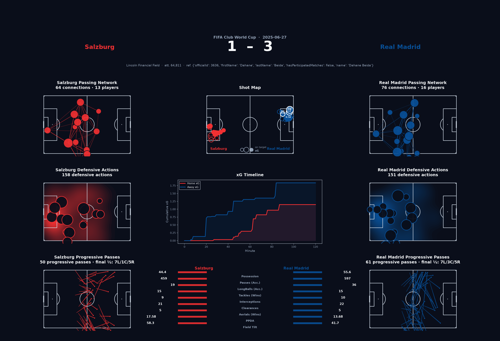

# football-analytics-tutorials

Open-source football analytics — now built around a **match report skill** that
turns any WhoScored match URL into a polished, shareable report by merging two
data sources automatically.



## ⚡ The Skill: `football-match-report`

Given **any WhoScored match URL**, the pipeline:

1. **Scrapes WhoScored** (headless Chromium) → full event stream: passes,
   tackles, carries, recoveries with coordinates.
2. **Auto-resolves the FotMob match id** from the match date + team names and
   fetches shots with **xG**, the native momentum series, official stats,
   player of the match, and **real team colors**.
3. **Renders** a dark editorial dashboard (passing networks, shot map,
   defensive-action heatmaps, progressive passes, xG timeline, match stats)
   plus a self-contained HTML report with auto-generated takeaways.

No API keys, no manual Selenium sessions, no rotating tokens, no hardcoded
team ids — it works for any match on WhoScored (Club World Cup, Premier
League, etc.).

### Quick start

```bash
# 1. Install deps (uv)
uv sync --extra scrape

# 2. One-time browser install (for WhoScored)
uv run playwright install chromium

# 3. Scrape any match (WhoScored + FotMob merged)
uv run python skill/football-match-report/scripts/scrape_match.py \
  "https://www.whoscored.com/matches/1873310/live/international-fifa-club-world-cup-2025-salzburg-real-madrid" \
  --out ./data

# 4. Render the report (offline)
uv run python skill/football-match-report/scripts/render_report.py \
  --data ./data --out ./report
```

Outputs: `report/match_report.png` + `report/match_report.html`

### Install as a Hermes/agent skill

```bash
# copy into your skills dir (macOS/Linux)
mkdir -p ~/.hermes/skills/data-science
cp -R skill/football-match-report ~/.hermes/skills/data-science/
```

Then any agent session can load it via its name. Full usage, metric
definitions and pitfalls are in
[`skill/football-match-report/SKILL.md`](skill/football-match-report/SKILL.md)
and [`references/metrics.md`](skill/football-match-report/references/metrics.md).

## What's Included

| Path | What it is |
|------|-----------|
| `skill/football-match-report/` | The skill: `SKILL.md`, `scripts/scrape_match.py`, `scripts/render_report.py`, metric reference |
| `notebooks/match_dashboard_template.ipynb` | Original 2025 notebook (kept for reference) |
| `notebooks/cwc_scraping_test.ipynb` | Original scraping experiments (kept for reference) |
| `data/` | Sample scraped data (events, shots, xT grid) |

## What changed in v2 (the makeover)

- **One URL in, full report out** — the old notebook needed manual Selenium,
  ChromeDriver, a rotating FotMob `x-mas` token, hardcoded team ids/colors
  and six duplicated "Experiment" cells. The skill is two commands, ~1,100
  lines of clean code, zero hardcoding.
- **FotMob endpoint modernized** — `matchDetails` moved to `/api/data/` and
  no longer requires a token; the skill uses the new path.
- **Real team colors** from FotMob's `teamColors` payload (no more
  hardcoded hex).
- **New metrics**: xG timeline, native match momentum, PPDA, field tilt,
  high turnovers, progressive passes with final-third zone split.
- **New rendering**: scoreboard header, editorial dark themes (`cobalt`,
  `midnight`, `paper`), HTML report with stats tables + takeaways.

## License

MIT — see [LICENSE](LICENSE).

*Data © WhoScored and FotMob. For personal/educational use; respect each
site's terms and rate limits (one match at a time).*
